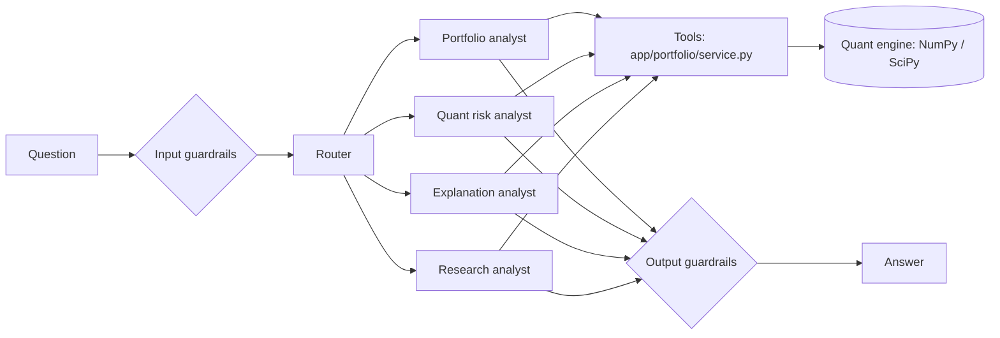

# Quant Risk Copilot

A multi-asset **portfolio risk engine** with an AI assistant on top. You ask "which asset drives my risk?"
or "did my VaR model pass backtesting?"; Gemini (via Google ADK) picks the right tool and explains the answer.

**The design rule: Python computes, the LLM explains.** Every number comes from a tested NumPy/SciPy engine in
`app/portfolio/`. Agents never calculate or invent figures.

> All data is synthetic. Educational only, not investment advice.

## What it does

| Area | Implementation |
|---|---|
| Portfolio | Weighted returns, covariance/correlation, annualised volatility, long-only validation |
| Risk measures | Historical and parametric (normal) VaR, Expected Shortfall, sqrt-time horizon scaling (labelled approximation) |
| Risk attribution | Euler decomposition of volatility, diversification ratio, weight HHI |
| Volatility | EWMA (past-only, no look-ahead) and GARCH(1,1) fitted by Gaussian MLE (own SciPy implementation, cross-checked vs `arch` when installed) |
| Validation | Rolling-window out-of-sample VaR backtests: Kupiec POF, Christoffersen independence, conditional coverage, Basel traffic light |
| Stress testing | Equity crash, inflation shock, rally, global risk-off |
| Agents | Router + Portfolio, Quant Risk, Research and Explanation analysts (Google ADK) |
| Safety | Input/output guardrails: prompt-injection, off-topic, PII masking, prompt-leak checks |



## Example output (bundled synthetic data, 756 days, 1,000,000 portfolio)

Portfolio: 40% NIFTY50, 30% GOVT_BOND, 20% GOLD, 10% USD_INR. Annualised volatility **6.5%**.

| Asset | Capital weight | Share of risk |
|---|---|---|
| NIFTY50 | 40% | **74.3%** |
| GOLD | 20% | 20.7% |
| GOVT_BOND | 30% | 3.0% |
| USD_INR | 10% | 2.0% |

| 99%, 1-day | VaR | Expected Shortfall |
|---|---|---|
| Historical | 12,624 (1.26%) | 19,466 (1.95%) |
| Parametric | 9,586 (0.96%) | 10,983 (1.10%) |

Parametric understates tail risk here because the data are fat-tailed (Student-t shocks, volatility clustering).
Backtests agree (250-day rolling window, 99%):

| Model | Exceptions (expected 5.1) | Kupiec p | Christoffersen p | Basel zone |
|---|---|---|---|---|
| Historical | 8 | 0.23 | 0.004 | yellow |
| EWMA | 9 | 0.11 | 0.007 | yellow |
| Parametric | 12 | 0.008 | 0.002 | red |

No model passes both tests: exceptions cluster in the volatility regime, which is exactly what the independence test
is for. GARCH(1,1) fit: alpha 0.105, beta 0.818, persistence 0.924, converged.
Stress: equity crash costs -53,000 (-5.3%), the worst of the four scenarios.

## Run it

Python 3.10+, free Gemini key from https://aistudio.google.com/apikey

```bash
python -m venv .venv && source .venv/bin/activate      # Windows: .venv\Scripts\Activate.ps1
pip install -r requirements.txt
python -m pytest -q                                    # engine tests, no API key needed

export GOOGLE_GENAI_USE_VERTEXAI=FALSE GOOGLE_API_KEY=your-key   # PowerShell: $env:NAME="value"
uvicorn app.main:app --reload --port 8080
curl -X POST localhost:8080/chat -H 'content-type: application/json' \
     -d '{"message":"Which asset contributes most to my portfolio risk?"}'
```

Use the engine without the AI:

```python
from app.portfolio import service
service.calculate_var(0.99, 1, "both")
service.backtest_var(0.99, 250, "ewma")
```

Your own data: set `PORTFOLIO_CSV` (`asset,asset_class,market_value`) and `ASSET_RETURNS_CSV`
(`date` + one daily-return column per asset). Regenerate sample data with `python data/generate_sample_data.py`.

Sample questions: *What is my allocation? Which asset contributes most to risk? Calculate 99% VaR and ES.
Compare GARCH and EWMA forecasts. Did my VaR model pass backtesting? Why might my VaR be rising? What does Expected Shortfall mean?*

## Assumptions and limitations

- Long-only, constant weights, one-day returns; multi-day risk uses square-root-of-time (i.i.d. approximation).
- Parametric VaR assumes normal returns; understates fat tails (see backtest above).
- GARCH uses Gaussian quasi-likelihood and a constant mean; sample covariance is estimated over the full window.
- Stress shocks are hypothetical instantaneous moves in position value.
- Guardrails are pattern checks, a first layer rather than a full defence.
- Synthetic data: results show the method, not real market behaviour.

## Layout

```
app/portfolio/   portfolio_engine, risk_metrics, risk_attribution, volatility_models, backtesting,
                 stress_testing, service (agent tools)
app/agents/      portfolio / quant / research / explanation agents
app/agent.py     router      app/main.py FastAPI + retry + JSON logs      app/guardrails.py
tests/           64 tests: engine maths, hand-computed examples, no-look-ahead, tools, guardrails
```

Not built yet: Streamlit dashboard, document RAG over Basel/FRTB papers.
