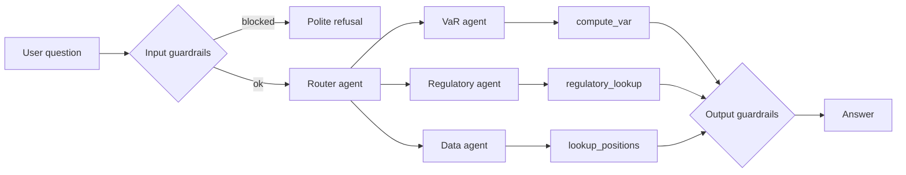

# Market Risk Assistant

A chatbot for market-risk questions: VaR, the Volcker Rule, and desk positions and P&L.
It is built with **Google ADK** and **Gemini**, and served through a **FastAPI** endpoint.

The important design choice: **numbers come from Python code, not from the AI.**
The AI decides which tool to call and explains the result. It never makes up a figure.

> All data is synthetic. Answers are for learning only, not investment or compliance advice.

## How it works



| Agent | What it does | Tool it uses |
|---|---|---|
| Router | Reads the question and passes it to the right agent | none |
| VaR agent | Value at Risk and Expected Shortfall for a portfolio | `compute_var` |
| Regulatory agent | Short notes on Volcker Rule, Basel/FRTB, backtesting | `regulatory_lookup` |
| Data agent | Positions and P&L for a desk (rates, credit, equities, fx) | `lookup_positions` |

## Guardrails

| When | Check | What happens |
|---|---|---|
| Before the AI | Prompt injection ("ignore previous instructions") | Blocked |
| Before the AI | Question not about market risk | Blocked |
| Before the AI | Emails, PAN, Aadhaar, card numbers | Masked |
| After the AI | Personal data in the answer | Masked |
| After the AI | Answer reveals internal agent names | Blocked |

These are simple pattern checks, a good first layer rather than a full defence.

## Logging and errors

- Each request writes one JSON log line: how long it took, tokens used, which agents ran, and any error.
- If Gemini returns a temporary error (503 "high demand"), the app waits and retries up to 3 times.

## Run it (Windows PowerShell)

You need Python 3.10+ and a free Gemini API key from https://aistudio.google.com/apikey

```powershell
python -m venv .venv
.venv\Scripts\Activate.ps1
pip install -r requirements.txt

$env:GOOGLE_GENAI_USE_VERTEXAI="FALSE"
$env:GOOGLE_API_KEY="your-key-here"
uvicorn app.main:app --reload --port 8080
```

In a second window:

```powershell
Invoke-RestMethod -Method Post -Uri http://localhost:8080/chat -ContentType "application/json" -Body '{"message":"Compute 99% VaR for a 5000000 portfolio"}'
```

Mac/Linux users: activate with `source .venv/bin/activate` and set the variables with `export`.

Model names change over time. The default is set in `app/agent.py` (or set `MODEL`).
`python check_models.py` lists the models your key can use.

## Tests

```powershell
python -m unittest discover -s tests -t . -v
```

## Project layout

```
app/
  main.py          FastAPI endpoint, retry, logging
  agent.py         router agent and the 3 specialist agents
  risk_tools.py    VaR / Expected Shortfall maths, positions lookup, regulatory notes
  guardrails.py    input and output checks
  observability.py JSON log helpers
data/              synthetic returns and positions
tests/             unit tests for guardrails and risk maths
check_models.py    lists Gemini models available to your key
```
